### Lee Hyun Soung 👋

  &nbsp;
  

<h3>📚 Tech Stack</h3>

  
Backend

  

    &nbsp;
    &nbsp;
    &nbsp;
    &nbsp;
  

  
Database

  

    &nbsp;
    &nbsp;
    &nbsp;
  

  
Cloud & Infra

  

    &nbsp;
    &nbsp;
    &nbsp;
    &nbsp;
    &nbsp;
  

  
Frontend

  

    &nbsp;
    &nbsp;
    &nbsp;
  

  
Development Tool

  

    &nbsp;
    &nbsp;
    &nbsp;
    &nbsp;
    &nbsp;
    &nbsp;
  

<h3>📊 GitHub Status</h3>

  &nbsp;
  

